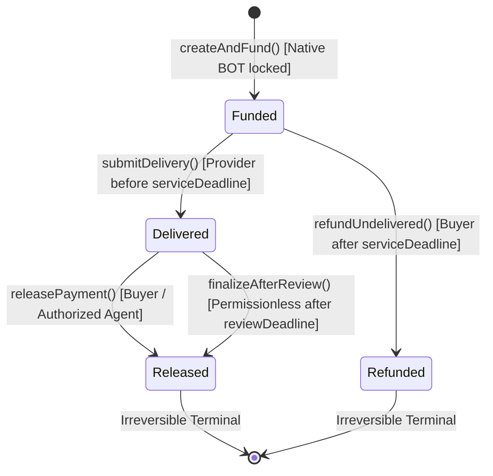

# BotPayEscrow — Smart Contract Architecture & Technical Design

## 1. Overview
`BotPayEscrow` is a gas-minimized, security-first, non-upgradeable machine-to-machine conditional escrow protocol deployed on **BOT Chain Mainnet (Chain ID 677)** at address:
`0x2d25345ff92C85E00E83c8ce1798f0CD66f6DCCA`

It enforces the autonomous service lifecycle:
$$\text{REQUEST} \longrightarrow \text{QUOTE/TERMS} \longrightarrow \text{FUND} \longrightarrow \text{DELIVER} \longrightarrow \text{VERIFY/ACCEPT} \longrightarrow \text{SETTLE}$$

Without requiring human checkout interfaces, token approve transactions, upgrade proxies, or admin backdoors.

---

## 2. State Machine & Lifecycle Transitions



### Invariant Rules
1. **Single Terminal State:** An agreement can reach either `Released` or `Refunded`, never both.
2. **Terminal Irreversibility:** Once `status` becomes `Released` or `Refunded`, no further transitions or fund movements are permitted.
3. **Escrow Solvency:** Contract native BOT balance strictly equals $\sum \text{amount}$ of all active agreements ($status \in \{\text{Funded}, \text{Delivered}\}$).
4. **No Double Payout:** Payment to the provider is executed at most once.
5. **No Double Refund:** Refund to the buyer is executed at most once.

---

## 3. Storage Layout & Packing Optimization

To minimize transaction execution gas and cold-storage `SSTORE` operations, the `Agreement` struct is tightly packed into **four 32-byte EVM storage slots** (128 bytes total):

| Slot | Field | Type | Size | Notes |
|:---:|:---|:---:|:---:|:---|
| **0** | `buyer` | `address` | 20 bytes | Agreement creator & payer |
| **0** | `status` | `AgreementStatus` | 1 byte | Enum: None(0), Funded(1), Delivered(2), Released(3), Refunded(4) |
| **0** | `serviceDeadline` | `uint40` | 5 bytes | Unix timestamp for provider delivery |
| **0** | `reviewDuration` | `uint32` | 4 bytes | Max seconds allowed for review (up to 30 days) |
| **0** | *padding* | - | 2 bytes | Free space in Slot 0 |
| **1** | `provider` | `address` | 20 bytes | Designated service provider beneficiary |
| **1** | `deliveryTimestamp` | `uint40` | 5 bytes | Recorded on `submitDelivery()` |
| **1** | `reviewDeadline` | `uint40` | 5 bytes | `deliveryTimestamp + reviewDuration` |
| **1** | *padding* | - | 2 bytes | Free space in Slot 1 |
| **2** | `amount` | `uint256` | 32 bytes | Locked native BOT in wei |
| **3** | `deliveryEvidenceHash` | `bytes32` | 32 bytes | Keccak256 hash of deliverable payload |

---

## 4. Function Interface & Specifications

### `createAndFund`
```solidity
function createAndFund(
    address provider,
    uint40 serviceDeadline,
    uint32 reviewDuration
) external payable returns (uint256 agreementId)
```
- Creates an agreement and locks native BOT in a single atomic transaction.
- Validates:
  - `provider != address(0)`
  - `provider != msg.sender` (prevents self-escrow griefing)
  - `msg.value > 0`
  - `serviceDeadline > block.timestamp`
  - `0 < reviewDuration <= 30 days`
- Increments `agreementCount` and stores packed agreement state.
- Emits `AgreementCreated`.

### `submitDelivery`
```solidity
function submitDelivery(uint256 agreementId, bytes32 deliveryEvidenceHash) external
```
- Restricts caller to `agreement.provider`.
- Requires `status == AgreementStatus.Funded`.
- Reverts if `block.timestamp > agreement.serviceDeadline`.
- Reverts if `deliveryEvidenceHash == bytes32(0)`.
- Calculates and sets `reviewDeadline = block.timestamp + reviewDuration`.
- Emits `DeliverySubmitted`.

### `releasePayment`
```solidity
function releasePayment(uint256 agreementId) external nonReentrant
```
- Callable by `agreement.buyer` or an agent authorized via `isAgentAuthorized`.
- Requires `status == AgreementStatus.Delivered`.
- Follows Checks-Effects-Interactions (CEI): updates `ag.status = AgreementStatus.Released` before making external call.
- Transfers `agreement.amount` native BOT to provider.
- Emits `PaymentReleased`.

### `finalizeAfterReview`
```solidity
function finalizeAfterReview(uint256 agreementId) external nonReentrant
```
- Permissionless settlement caller.
- Requires `status == AgreementStatus.Delivered`.
- Requires `block.timestamp > agreement.reviewDeadline`.
- Updates `ag.status = AgreementStatus.Released` before transfer.
- Transfers funds to provider.
- Emits `SettlementFinalized`.

### `refundUndelivered`
```solidity
function refundUndelivered(uint256 agreementId) external nonReentrant
```
- Callable by `agreement.buyer` or its authorized agent.
- Requires `status == AgreementStatus.Funded` (delivery was never submitted).
- Requires `block.timestamp > agreement.serviceDeadline`.
- Updates `ag.status = AgreementStatus.Refunded` before transfer.
- Refunds exact locked amount to buyer.
- Emits `RefundIssued`.

### `setAgentAuthorization`
```solidity
function setAgentAuthorization(address agent, bool authorized) external
```
- Enables autonomous off-chain agent wallets to act on behalf of a buyer address.
- Emits `AgentAuthorizationUpdated`.

---

## 5. Security & Trust Assumptions

1. **No Admin Privileges:** No owner, pause mechanism, upgrade proxy, or multisig override can confiscate or redirect locked funds.
2. **Evidence Hash Limitation:** `deliveryEvidenceHash` records a cryptographic reference to off-chain data (API response, inference receipt, dataset root). The smart contract guarantees payment custody and settlement rules, but does not verify off-chain semantic correctness.
3. **Reentrancy Protection:** All fund-moving functions apply strict Checks-Effects-Interactions pattern alongside a gas-optimized `nonReentrant` lock.
